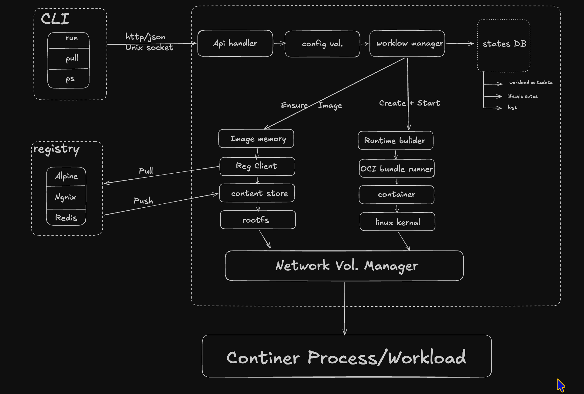

<h1 align="center"><code>Brain — workloads, under control</code></h1>

<samp>
Define a workload. Send it to the local daemon. Follow its lifecycle.
</samp>

 

 

<samp>ꜱᴍᴀʟʟ ᴇɴɢɪɴᴇ · ᴄʟɪ + ᴅᴀᴇᴍᴏ · ᴏᴄɪ ɪꜱ ᴛʜᴇ ᴅɪʀᴇᴄᴛɪᴏɴ</samp>

---

## <samp>› what is brain?</samp>

Brain is a Go project for understanding the pieces behind a container engine: a CLI, a local control API, workload lifecycle management, persistent state, logs, and a runtime adapter boundary.

Today, Brain runs **ordinary host processes** through braind. The OCI container backend is the destination; it is not implemented yet.

<samp>⚠ process mode is not a container or a security boundary. Run only workloads you trust.</samp>

## <samp>› features</samp>

| Capability | What Brain does today |
|---|---|
| **YAML workloads** | Validates a versioned workload schema, command, runtime, name, and environment keys. |
| **Local daemon** | Exposes a versioned HTTP API over an owner-only Unix socket. |
| **Workload lifecycle** | Starts, lists, inspects, stops, and removes named host processes. |
| **Logs** | Captures stdout and stderr separately, rotates each stream, and supports follow mode. |
| **Persistent metadata** | Saves workload state and marks previously running workloads failed after restart, since process reattachment is not implemented. |

## <samp>› workload flow</samp>

  

<samp>CURRENT: CLI → daemon → process &nbsp; · &nbsp; PLANNED: registry, OCI runtime, networking, volumes</samp>

For a process workload, the CLI validates YAML and calls the daemon over an owner-only Unix socket. The manager starts the host process, records lifecycle state, and captures its logs. The planned container path resolves an OCI image, prepares a root filesystem and bundle, then delegates container setup to an OCI runtime on Linux.

## <samp>› technology</samp>

- **Go** for the CLI, daemon, and workload manager
- **YAML v3** for strict workload configuration decoding
- **HTTP over Unix sockets** for local CLI-to-daemon requests
- **Go os/exec** for the current direct host-process backend
- **JSON state and local rotating log files** for persistence

## <samp>› quick start</samp>

Requires **Go 1.27+**.

~~~bash
# Build the CLI and daemon
go build -o brain ./cmd/brain
go build -o braind ./cmd/braind
~~~

Start the daemon from the repository root in one terminal:

~~~bash
./braind
~~~

In a second terminal, also from the repository root:

~~~bash
./brain validate examples/hello.yml
./brain run examples/hello.yml
./brain ps
./brain logs hello
~~~

Stop and remove it when you’re done:

~~~bash
./brain stop hello
./brain rm hello
~~~

The daemon creates `./brain.sock` in its working directory and stores workload metadata under the user cache directory. Run the CLI from that same directory so it can find the socket. Ctrl+C shuts the daemon down and stops managed processes.

## <samp>› describe a workload</samp>

~~~yaml
apiVersion: brain.dev/v1alpha1
kind: Workload
metadata:
  name: hello
spec:
  runtime: process
  command: ["go", "version"]
  workingDir: .
  env:
    APP_ENV: development
~~~

Commands are argument arrays and run directly; Brain does not invoke a shell implicitly. Set an explicit shell command when shell behavior is needed.

## <samp>› commands</samp>

| Command | Action |
|---|---|
| `brain health` | Check daemon health |
| `brain validate FILE` | Parse and validate YAML |
| `brain run FILE` | Create and start a workload |
| `brain ps` | List workloads |
| `brain get NAME` | Inspect workload ID and state |
| `brain logs NAME` | Print captured output |
| `brain logs -f NAME` | Follow output (one-second polling) |
| `brain stop NAME` | Interrupt; force-kill after five seconds if needed |
| `brain rm NAME` | Remove a stopped workload and its logs |

## <samp>› build path</samp>

~~~text
YAML + CLI + local API + process lifecycle + logs      ✓ current
OCI images + digest verification + root filesystem    → planned
OCI bundle + Linux runtime + namespaces / cgroups     → planned
Networking + mounts + Linux integration hardening     → planned
~~~

The container milestones require Linux development and verification. Until then, Brain is a workload control-plane prototype, not a Docker replacement.

<samp>Go · YAML · Unix sockets · Linux </samp>

